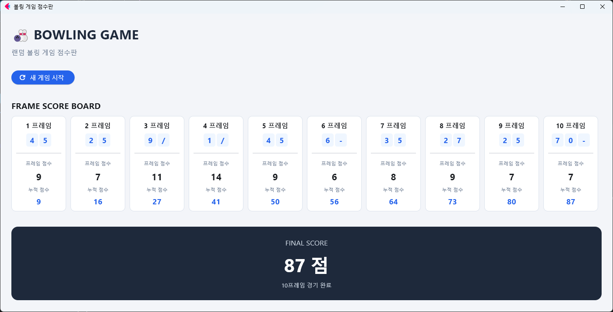
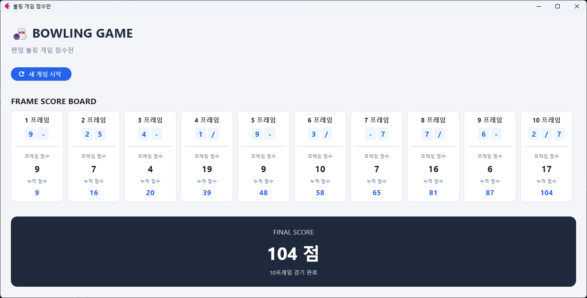

# 🎳 Python Bowling Scoreboard



Python과 Flet을 활용하여 구현한 볼링 게임 점수 관리 애플리케이션입니다.

랜덤으로 투구 결과를 생성하고, 볼링의 점수 계산 규칙에 따라 10프레임의 점수와 누적 점수를 계산하여 웹 UI로 보여줍니다.

## 📌 프로젝트 소개

기존 터미널 기반의 볼링 점수 계산 프로그램을 Flet을 활용한 웹 인터페이스로 확장한 프로젝트입니다.

볼링의 기본 규칙인 스트라이크, 스페어, 오픈 프레임을 구분하고 프레임별 점수 및 최종 점수를 확인할 수 있습니다.

## 🛠️ Tech Stack

| 구분 | 기술 |
|---|---|
| Language | Python |
| UI Framework | Flet 1.0.5 |
| Module | Random |

## ✨ 주요 기능

- **랜덤 투구 생성**: 1~10프레임의 투구 결과 자동 생성
- **스트라이크 판정**: 첫 번째 투구에서 10핀을 쓰러뜨린 경우
- **스페어 판정**: 두 번의 투구로 10핀을 쓰러뜨린 경우
- **오픈 프레임 판정**: 두 번의 투구 후 핀이 남은 경우
- **보너스 점수 계산**: 스트라이크와 스페어의 추가 점수 반영
- **프레임별 점수 관리**: 각 프레임의 점수 계산
- **누적 점수 계산**: 프레임별 누적 점수 표시
- **새 게임 시작**: 버튼을 통한 새로운 게임 실행

## 🎯 볼링 점수 계산 규칙

| 구분 | 조건 | 점수 |
|---|---|---|
| 스트라이크 (X) | 첫 투구에서 10핀 | 10점 + 다음 2구 |
| 스페어 (/) | 두 투구 합계 10핀 | 10점 + 다음 1구 |
| 오픈 프레임 | 두 투구 합계 10핀 미만 | 쓰러뜨린 핀의 합 |

※ 10프레임은 스트라이크 또는 스페어 달성 여부에 따라 추가 투구 기회가 주어집니다.

## 🖥️ 실행 방법

### 1. 저장소 복제

```bash
git clone https://github.com/깃허브아이디/python-bowling-scoreboard.git
cd python-bowling-scoreboard
```

### 2. 라이브러리 설치

```bash
pip install flet==1.0.5
```

### 3. 프로그램 실행

```bash
python main.py
```

## 📂 프로젝트 구조

```text
python-bowling-scoreboard/
│
├── main.py
└── README.md
```

## 📚 학습 내용

- Python 리스트를 활용한 프레임별 데이터 관리
- 함수 분리를 통한 기능별 코드 구성
- 조건문을 활용한 볼링 점수 규칙 구현
- 반복문을 활용한 10프레임 게임 처리
- 스트라이크 및 스페어 보너스 점수 계산
- Flet을 활용한 Python 기반 UI 구현

## 🚀 향후 개선 사항

- 사용자 직접 투구 결과 입력 기능
- 게임 기록 저장 및 조회 기능
- 여러 게임의 점수 비교 기능
- 사용자별 볼링 기록 관리 기능
